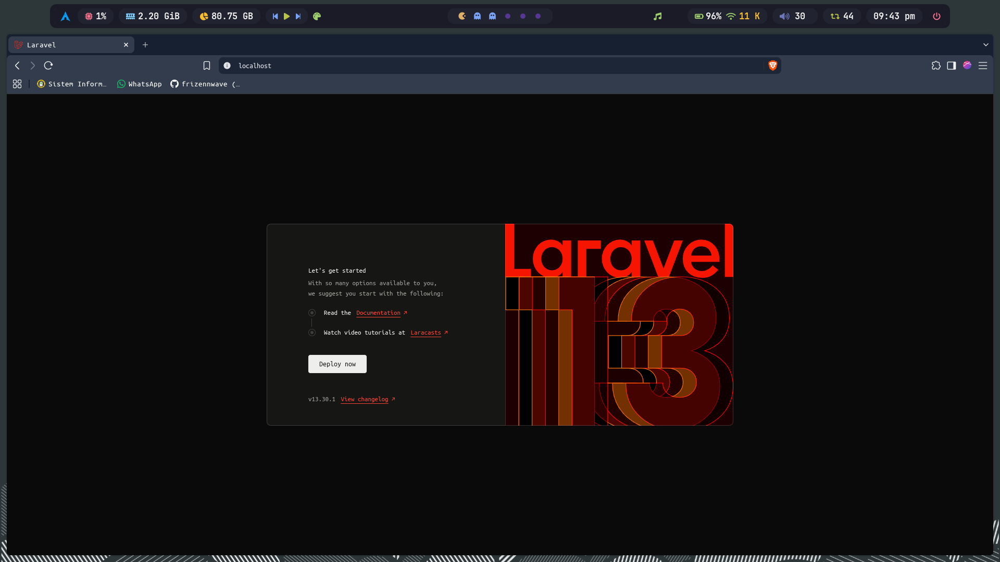

<p align="center"><a href="https://laravel.com" target="_blank"></a></p>
<h1 align="center">Sistem Informasi Akademik<br>MA Nur Muhammad</h1>
<hr>

**Sistem Informasi Akademik & Presensi Terpadu (SIAKAD)** untuk Madrasah Aliyah Nur Muhammad Jombang berbasis **Web dan Mobile**.

Project ini dibuat untuk membantu pengelolaan data akademik dan presensi sekolah dalam satu sistem yang terintegrasi. Sistem memanfaatkan **QR Code** untuk mendukung proses presensi siswa, presensi guru/tenaga kependidikan, serta akses akun siswa.

## Fitur Utama

### Web Admin
- Mengelola data siswa, guru, kelas, mata pelajaran, dan tahun ajaran.
- Import dan export data akademik.
- Generate QR Code untuk Kartu Tanda Pelajar.
- Verifikasi dan penerbitan Surat Izin/Sakit dengan QR Code.
- Presensi Guru/Tenaga Kependidikan.

### Mobile
- Scan QR Code untuk presensi siswa.
- Scan QR Code Surat Izin/Sakit.
- Input dan pengelolaan nilai siswa.
- Login siswa menggunakan QR Code Kartu Tanda Pelajar.
- Melihat riwayat presensi dan nilai.
- Multi-account switching untuk wali murid yang memiliki lebih dari satu anak.

## Teknologi

- Laravel
- MySQL
- REST API
- Laravel Sanctum
- Docker / Laravel Sail
- QR Code

## Pengguna

1. **Admin / Tata Usaha** — mengelola data dan administrasi melalui Web Admin.
2. **Guru / Tenaga Kependidikan** — melakukan presensi dan mengelola nilai melalui aplikasi Mobile.
3. **Siswa / Wali Murid** — melihat presensi dan informasi akademik melalui aplikasi Mobile.

---

## Screenshot

Screenshot hasil implementasi sistem dapat dilihat pada bagian berikut.
Initial Project


---

## Kendala & Solusi

Selama proses pengembangan, beberapa kendala dan solusi yang ditemukan dapat dicatat pada bagian ini.

| Kendala | Solusi |
|---|---|
| Proses presensi manual berpotensi menyebabkan kesalahan dan manipulasi data | Menggunakan presensi berbasis QR Code dengan alur scan |
| Data akademik dan presensi perlu dikelola dalam satu sistem | Mengintegrasikan Web Admin, Mobile, REST API, dan PostgreSQL |
| Wali murid dapat memiliki lebih dari satu akun siswa | Menyediakan fitur Multi-Account Switching |
| QR Code perlu mencegah pemalsuan | Data QR Code dirancang menggunakan mekanisme enkripsi dan secret key |

---

## Dokumen Pendukung

Dokumen pendukung project tersedia di dalam folder [`docs`](./docs).

Folder tersebut digunakan untuk menyimpan dokumen yang berkaitan dengan perancangan dan pengembangan sistem, seperti:

- Requirement / kebutuhan sistem
- Use Case
- Dokumentasi perancangan
- Screenshot hasil implementasi
- Dokumen pendukung lainnya

---

## Quality Assurance (QA)

Pengujian kualitas dilakukan pada antarmuka **web admin (panel Filament di `/dashboard`)** memakai Playwright dan Claude Code. Seluruh berkas QA berada di folder [`QA/`](./QA).

**Dikerjakan oleh:** `<NAMA LENGKAP>` (`<NIM>`)

### Dokumen hasil QA

| Dokumen | Lokasi |
|---|---|
| Laporan QA (PDF) | [`QA/reports/Website_QA_Testing_Report.pdf`](./QA/reports/Website_QA_Testing_Report.pdf) |
| Panduan pengguna (PDF) | [`QA/reports/Website_User_Tutorial.pdf`](./QA/reports/Website_User_Tutorial.pdf) |
| Katalog test case | [`QA/reports/Test_Case_Catalogue.xlsx`](./QA/reports/Test_Case_Catalogue.xlsx) |
| Daftar bug | [`QA/bugs/bugs.json`](./QA/bugs/bugs.json) |
| Handover QA | [`QA/discovery/documents/QA_Handover.md`](./QA/discovery/documents/QA_Handover.md) |
| Test otomatis | [`QA/tests/`](./QA/tests) |

### Ringkasan hasil

Sumber: `results/test-results.json` pada run terakhir (lingkungan lokal, 23 November 2026).

| Metrik | Nilai |
|---|---|
| Test case terdaftar | 15 |
| Dieksekusi (PASS + FAIL) | 13 |
| PASS / FAIL / BLOCKED | 13 / 0 / 2 |
| Pass Rate | 100% (denominator 13) |
| Bug aplikasi terkonfirmasi | 0 |

Cakupan: autentikasi, navigasi sidebar, kontrol akses antar-role (Admin, Guru, Murid), serta tampilan Master Data dan Student Enrollment. Pass Rate 100% berlaku untuk 13 test read-only dan **tidak** berarti aplikasi bebas bug.

**Di luar scope:** REST API (belum selesai), aplikasi Mobile, operasi tulis (create, edit, delete, bulk delete, ditandai BLOCKED), serta pengujian performa dan keamanan mendalam.

**Temuan proses:** pada run awal 3 test gagal karena login Admin berulang (diduga pembatasan percobaan login Filament). Ini bukan bug aplikasi dan sudah diperbaiki di sisi test dengan sesi login tersimpan. Detailnya ada di laporan QA.

### Menjalankan ulang test

Prasyarat: Node.js 20.6+, aplikasi berjalan di `http://localhost` (mis. `./vendor/bin/sail up -d`).

```bash
cd QA
npm install
npx playwright install chromium
cp .env.example .env        # isi BASE_URL dan akun uji tiap role
npm run test:env            # validasi environment
npm test                    # jalankan semua test
```

Kredensial hanya di `.env` lokal. Berkas `.env`, `auth/`, `results/`, dan `archive/` tidak di-commit.

---

## Status

🚧 **Development**

Project ini dikembangkan sebagai tugas perkuliahan sekaligus implementasi Sistem Informasi Akademik dan Presensi Terpadu untuk MA Nur Muhammad Jombang.
